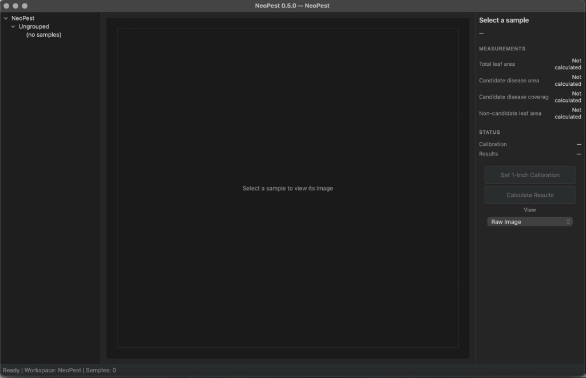
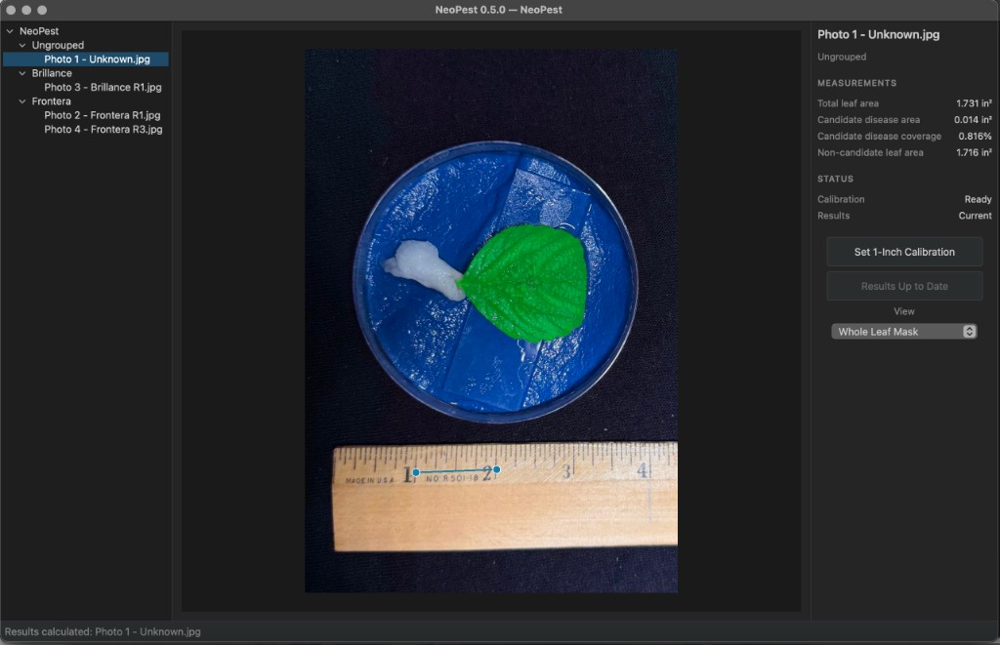
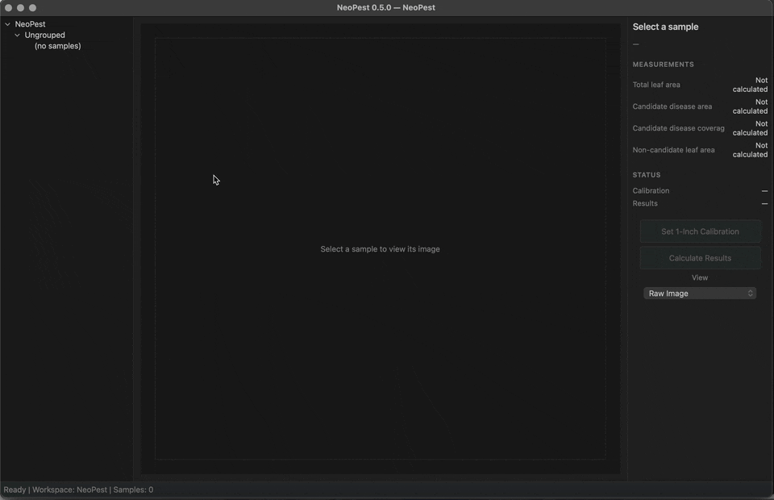
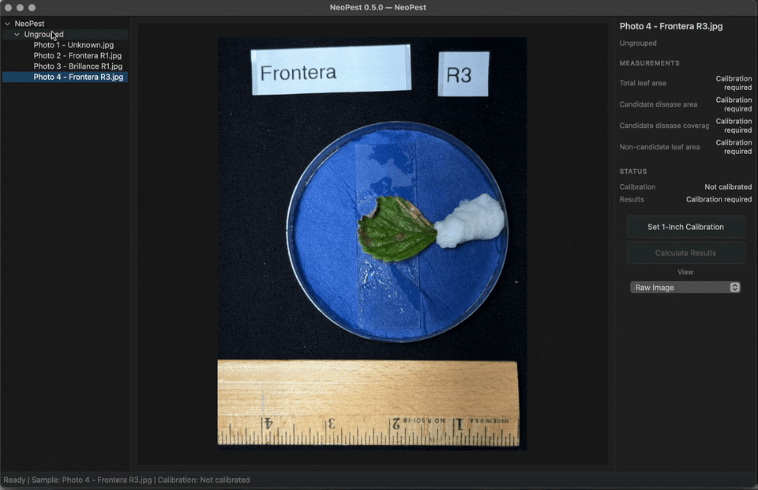
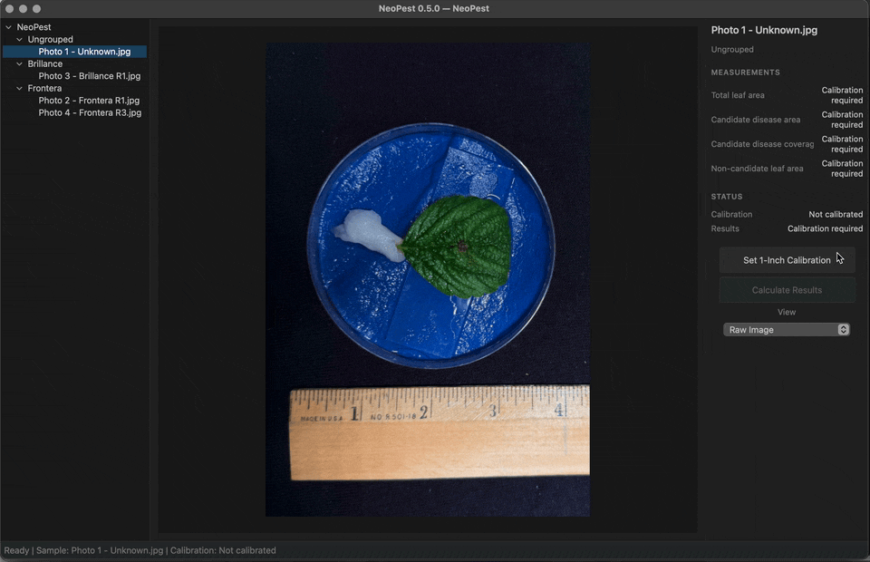
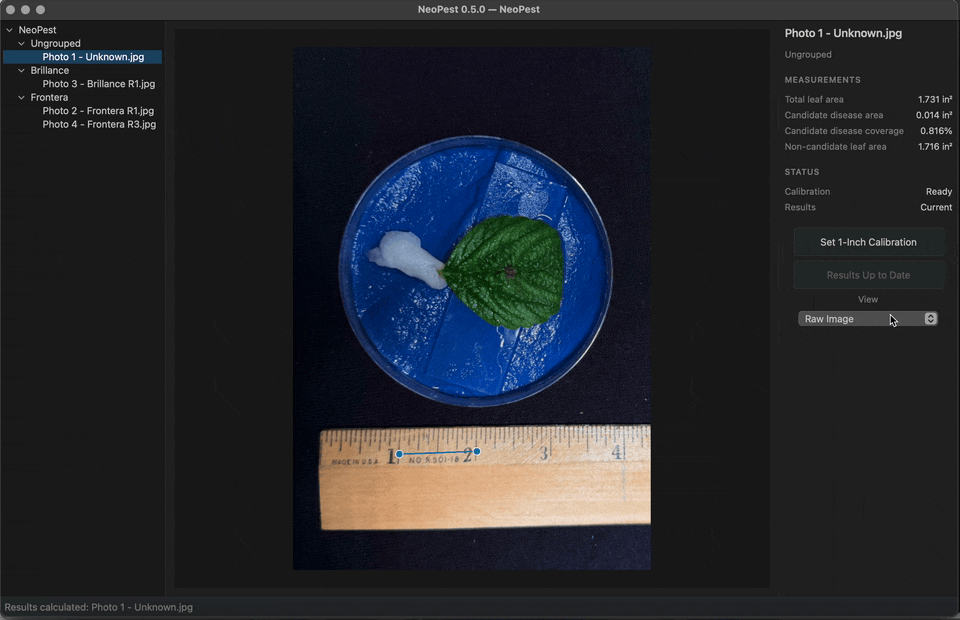

# NeoPest

NeoPest is a computer-vision application for measuring strawberry leaf area and candidate brown/necrotic disease from individual strawberry leaf images.

## NeoPest Interface

### Empty Workspace



### Analysis Workspace



## Current Capabilities

- Manual image-specific calibration
- Whole-leaf segmentation
- Candidate disease segmentation
- Display-only preview modes (**View** dropdown)
- Persisted measurements (total leaf area, candidate disease area, coverage, non-candidate leaf area)
- Workspace and condition-group management

## Current Limitations

- Candidate disease detection is not biologically validated; outputs are estimates, not a diagnosis
- One image at a time — no batch processing
- No CSV or JSON export; no saved mask export
- No automatic calibration or calibration propagation between images

## Installation (macOS)

Verified on **macOS** with **Python 3.10 or newer**. A graphical display is required.

**Command Line Tools** (includes Git):

```bash
xcode-select --install
git --version
```

**Python** — install from [python.org](https://www.python.org/downloads/macos/), then verify:

```bash
python3 --version
pip3 --version
```

**Clone, dependencies, and launch:**

```bash
git clone https://github.com/Sapkota-Lab/neopest.git
cd neopest
python3 -m venv .venv
source .venv/bin/activate
python3 -m pip install --upgrade pip
python3 -m pip install -r requirements.txt
python3 run_app.py
```

Or: `./run_app.sh` (with `.venv` activated)

First launch creates workspace `~/Documents/NeoPest` with metadata file `neopest_workspace.json`.

| Problem | What to try |
|---------|-------------|
| `python3` or `git` not found | Install Python or run `xcode-select --install`; reopen Terminal. |
| `ModuleNotFoundError` | Run `source .venv/bin/activate` before launching. |
| Workspace not visible | Check `~/Documents/NeoPest` or **File → Open Workspace**. |

## Verify Installation

```bash
python3 --version
git --version
source .venv/bin/activate
python3 -m compileall neopest
python3 run_app.py
```

If NeoPest opens and `~/Documents/NeoPest` is available, installation is complete. A full test-suite run is not required for normal install verification.

## First Use

1. Launch NeoPest (`python3 run_app.py` with `.venv` activated).
2. **Import** a leaf image (**File → Import Images**).

   

3. Create or select a **condition group** (**File → New Condition Group** or right-click in Explorer).

   

4. Select the sample and perform **manual 1-inch calibration** on the ruler.

   

5. Use **View** to inspect masks (display only): Raw Image, Whole Leaf Mask, Candidate Disease Mask, Healthy Tissue Preview.

   

6. Click **Calculate Results**.
7. Review measurements in the Inspector (see below).
8. If status shows **Recalculation required**, click **Recalculate Results**.

Back up `~/Documents/NeoPest` to preserve images and results.

## Measurements

| Measurement | Description |
|-------------|-------------|
| Total leaf area | Area of the segmented leaf |
| Candidate disease area | Brown/necrotic tissue identified by the deterministic algorithm |
| Candidate disease coverage | Candidate disease area relative to total leaf area |
| Non-candidate leaf area | Remaining segmented leaf area |

Areas are in square inches (in²); coverage is a percent.

## Result Status

| Status | Meaning |
|--------|---------|
| Current | Measurements match the current image and calibration |
| Recalculation required | Inputs changed since the last calculation |
| Calibration required | Manual calibration is required before calculation |
| Not calculated | Results have not been generated |
| Calculation failed | Segmentation was unsuccessful |

## Scientific Notes

- One image at a time; calibration is manual and specific to each image.
- Deterministic computer vision — not machine learning.
- Candidate disease estimates brown/necrotic-looking tissue; **not** confirmed disease or a diagnosis.
- Full precision stored internally; display rounded to three decimal places.

## Windows (PowerShell)

```powershell
git clone https://github.com/Sapkota-Lab/neopest.git
cd neopest
py -m venv .venv
.venv\Scripts\Activate.ps1
python -m pip install --upgrade pip
python -m pip install -r requirements.txt
python run_app.py
```

Default workspace: `Documents\NeoPest` with `neopest_workspace.json`.

## Testing

```bash
source .venv/bin/activate
python3 -m compileall neopest tests
python3 -m unittest discover -s tests -v
```
